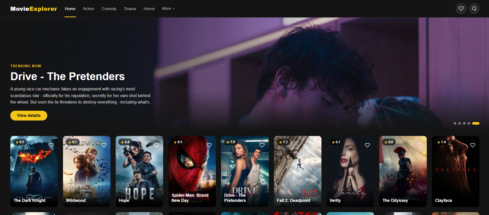
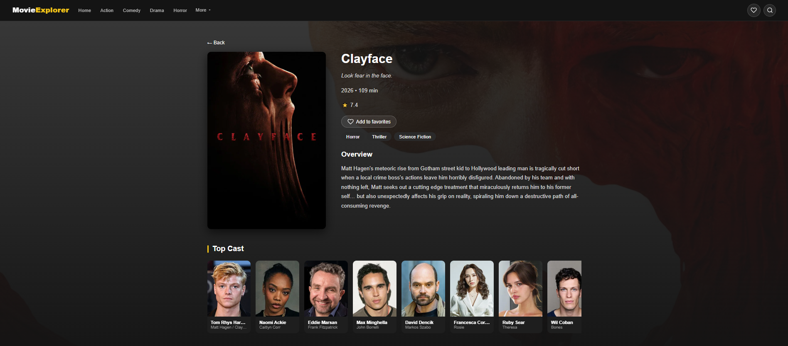
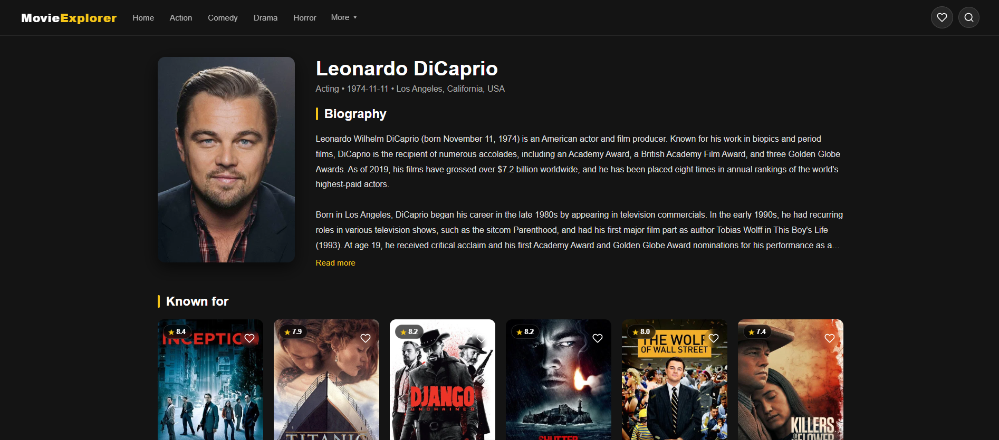
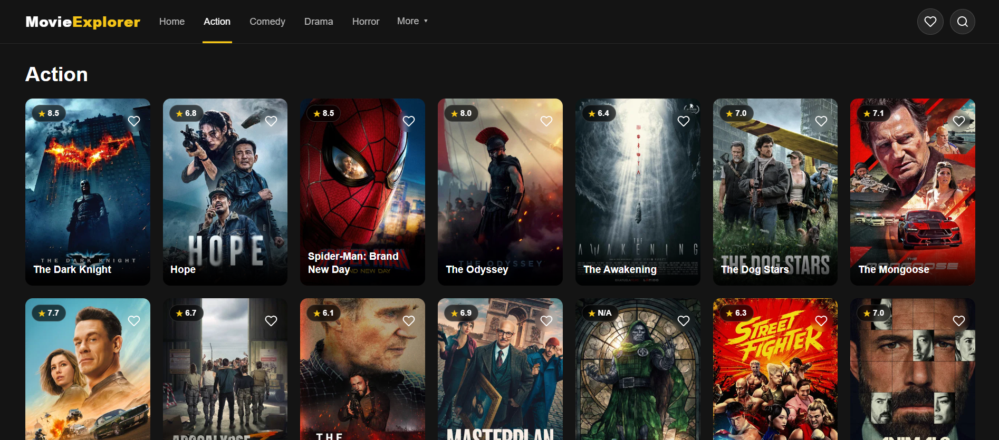
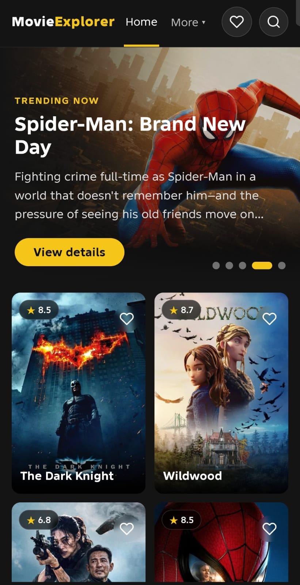

# Movie Explorer

A responsive movie discovery app built with **React**. Browse trending movies, search, filter by genre, explore cast members, and save your favorites.

**[Live Demo](https://movie-explorer-beta-five.vercel.app)**



## Features

- **Trending banner:** rotating hero slider with the most popular movies
- **Search:** find any movie by title from the navbar
- **Genre browsing:** Action, Comedy, Drama, Horror and more, loaded from the API
- **Movie details:** poster, tagline, runtime, rating, genres, overview and a backdrop image
- **Cast:** scrollable top cast section, with a page for every actor showing their biography and filmography sorted by popularity
- **Favorites:** save movies and keep them after closing the browser (stored in `localStorage`)
- **Loading, error and empty states** on every page
- **Fully responsive**, from mobile to desktop

## Screenshots

|            Movie details            |       Cast and actor page       |
| :---------------------------------: | :-----------------------------: |
|  |  |

|           Genre page            |              Mobile               |
| :-----------------------------: | :-------------------------------: |
|  |  |

## Built With

- [React](https://react.dev/) (hooks: `useState`, `useEffect`, `useRef`)
- [Vite](https://vite.dev/)
- [React Router](https://reactrouter.com/) for multi-page navigation
- [TMDB API](https://www.themoviedb.org/documentation/api) for movie data
- Plain CSS (grid, flexbox, media queries)
- Deployed on [Vercel](https://vercel.com/)

## What I Practiced

- Fetching data from a REST API and handling loading and error states
- Dynamic routes (`/movie/:id`, `/genre/:id`, `/person/:id`) and URL search params
- Building a custom hook (`useFavorites`) that syncs state with `localStorage`
- Reusable components (`MovieCard`, `Navbar`, icons) and lifting logic up
- Closing menus on outside click and keyboard (`Escape`) events
- Responsive layouts and keeping API keys out of the repository with environment variables

## Getting Started

**1. Clone the repository**

```bash
git clone https://github.com/hazard10oo/movie-explorer.git
cd movie-explorer
```

**2. Install dependencies**

```bash
npm install
```

**3. Add your TMDB API key**

Get a free key from [themoviedb.org](https://www.themoviedb.org/settings/api), then create a `.env` file in the project root:

```
VITE_TMDB_KEY=your_api_key_here
```

**4. Run the app**

```bash
npm run dev
```

Open the local URL shown in the terminal (usually `http://localhost:5173`).

## Project Structure

```
src/
├── components/   Navbar, MovieCard, icons, Footer
├── hooks/        useFavorites
├── pages/        Home, MovieDetails, GenrePage, PersonPage, Favorites
├── App.jsx       routes
└── main.jsx      entry point
```

## Credits

This product uses the TMDB API but is not endorsed or certified by TMDB.

---

Built by [Mohamed](https://github.com/hazard10oo)
